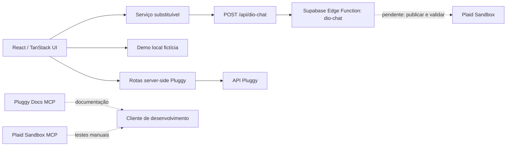

# Nexora Finance

O **Nexora Finance** é uma demonstração educacional de chat financeiro em português com o assistente **Dio**. A interface explora contas, saldos e transações fictícias com Pluggy, Supabase e ferramentas de desenvolvimento MCP. Não é um produto bancário nem deve ser usado para decisões financeiras reais.

> **Demonstração · Dados fictícios.** O modo local não precisa de credenciais. O Sandbox da Plaid e o Sandbox da Pluggy também usam dados sintéticos.

## Demonstração e estado da entrega

- **Demo pública:** <https://pocketwise-finance-chat.lovable.app>
- A versão publicada conhecida é anterior a este checkout e não comprova a integração atual com a Edge Function nem as melhorias deste repositório. Atualize e revise o projeto Lovable antes de publicar uma nova versão.
- Nenhum deploy/publicação automática foi feito por este trabalho.
- A Edge Function `dio-chat` agora está versionada em [`supabase/functions/dio-chat/index.ts`](./supabase/functions/dio-chat/index.ts). Ela lê contas e transações da Plaid Sandbox (`/accounts/get` e `/transactions/get`, 90 dias, paginado, com novas tentativas para `PRODUCT_NOT_READY`). Falta apenas implantá-la e validar no seu projeto Supabase: veja [`docs/deploy-dio-chat.md`](./docs/deploy-dio-chat.md).
- **Sobre o MCP:** a função chama os mesmos endpoints da Plaid Sandbox que o `mcp-server-plaid` usa, mas diretamente por HTTP (um MCP local não roda dentro de uma Edge Function). O MCP da Plaid foi usado no desenvolvimento para criar o Item e conferir os dados (evidências em `docs/evidencias/`); o MCP da Pluggy foi usado como documentação.

## Cenário e origem dos dados

O cenário é um chat financeiro demonstrativo: a pessoa consulta contas de exemplo, dinheiro disponível, dívidas de cartão, movimentações e saídas por categoria. Não se afirma a existência de uma instituição, varejista ou agência de viagens parceira.

| Informação | Origem | Limite |
| --- | --- | --- |
| Contas e saldos locais | `DEMO_ACCOUNTS` em `src/lib/finance.ts` | Dados fictícios estáticos, não obtidos da Plaid em tempo real. |
| Transações locais | `DEMO_TRANSACTIONS` em `src/lib/finance.ts` | Amostra ilustrativa de oito registros; não é um extrato completo nem conciliado. |
| Contas e transações Pluggy | Rotas server-side Pluggy e provedor do painel | Disponíveis após autorização de uma sessão Pluggy; não recalculam o saldo local. |
| Resposta de Dio | `dio-chat` (`supabase/functions/dio-chat`) via `src/lib/chat-service.ts` | Respostas por regras (modo `regras`), sem IA generativa. Dados da Plaid Sandbox; em falha, a UI identifica o fallback local. |
| Plaid Sandbox | MCP local configurado em `.vscode/mcp.json` | Laboratório separado; suas consultas não alimentam os dados estáticos do dashboard. |
| Documentação Pluggy | MCP remoto `https://mcp.pluggy.ai/mcp` | Documentação, não acesso a contas bancárias. |

O sinal das transações segue a convenção Plaid adotada pelo app: valor positivo é saída e negativo é entrada. **O saldo bancário não é calculado a partir da amostra de transações.** Dívida e crédito disponível do cartão permanecem separados do dinheiro em conta. Não há conversão automática entre moedas.

## Arquitetura



O fluxo do chat mantém a integração fora dos componentes: UI → serviço substituível → rota server-side → Supabase Edge Function. A rota valida entradas com Zod, limita a pergunta a 1.000 caracteres, repete falhas temporárias até três tentativas e valida o formato de resposta. Logs estruturados não registram perguntas, tokens ou credenciais.

Os MCPs Pluggy e Plaid configurados no ambiente de desenvolvimento não são chamados pelo navegador nem pelo chat publicado. O Pluggy Docs MCP é documental; ele não é, por si só, um MCP de dados financeiros.

## Funcionalidades e avaliação

- Painel de contas e transações, cinco sugestões no código, nova conversa e histórico local.
- Resposta do chat em Markdown com tabelas roláveis horizontalmente, modo e metadados. O selo de integração ativa depende de uma resposta remota válida; em falha, a UI apresenta a resposta local como demonstração.
- Insights descritivos dos registros carregados: categoria com maior saída, maior saída individual e média por saída. Entradas são excluídas e moedas diferentes não são somadas.
- Classificador determinístico de descrições com fallback `Outros`.
- Testes offline para helpers Plaid, contratos, retries, insights, configuração MCP e painel.
- GitHub Actions para testes, avaliação de categorização, typecheck, lint e build.

### Avaliação da categorização

`data/categorization-evaluation.csv` contém **120 transações fictícias rotuladas**, com 12 exemplos por classe. O classificador acertou **120/120 (100%)** neste conjunto. Reproduza a avaliação com:

```bash
bun run evaluate:categorization
```

Esse resultado não representa acurácia em transações reais nem estima generalização: as descrições foram construídas para exercitar as regras do classificador. A melhoria pendente é avaliar 100–200 transações Sandbox independentes, rotuladas manualmente, e publicar protocolo, matriz de confusão e erros.

## Executar localmente

Requisitos: Bun e Node.js.

```bash
bun install
bun run dev
```

Verificações automatizadas:

```bash
bun run test
bun run evaluate:categorization
bun run typecheck
bun run lint
bun run build
```

O modo demonstração local não requer credenciais. Para testar integrações, configure variáveis somente no ambiente server-side conforme `.env.example`. Nunca use prefixo `VITE_` para segredos. A chave Supabase `service_role` tem privilégios elevados e nunca deve entrar no bundle do navegador.

## Configuração dos MCPs de desenvolvimento

### Pluggy Docs MCP

`.vscode/mcp.json` configura `pluggy` como servidor HTTP em `https://mcp.pluggy.ai/mcp`, sem chave. Reinicie o cliente e verifique `/mcp`. O servidor serve para pesquisar documentação e não cria ou autoriza uma conexão bancária.

Para a definição conceitual de **Item**, consulte [`docs/pluggy-mcp-item.md`](./docs/pluggy-mcp-item.md).

### Plaid Sandbox MCP

No Windows, a configuração STDIO chama `.vscode/start-plaid-mcp.ps1`. O launcher lê `PLAID_CLIENT_ID` e `PLAID_SECRET` de `.env.plaid` e inicia `uvx mcp-server-plaid`. Esse arquivo é ignorado pelo Git. Crie-o localmente, instale `uv`/`uvx`, ajuste o caminho de `uvx.exe` no launcher se necessário e reinicie o cliente.

Não versionar nem compartilhar `.env.plaid`, Client ID, secret, access token ou capturas com credenciais. O teste automatizado verifica a configuração, mas não inicia o servidor nem chama a Plaid.

### Evidência de execução Plaid Sandbox

A consulta manual pelo MCP foi realizada e registrada em [`docs/evidencias/P07-RESULTADO.md`](./docs/evidencias/P07-RESULTADO.md). O relatório registra 5 transações em USD no período de 28/06/2026 a 25/09/2026, paginação concluída em uma página e três observações agregadas: status por moeda, soma algébrica e maior movimento absoluto. Houve uma resposta inicial `PRODUCT_NOT_READY`; a nova tentativa foi concluída com sucesso. O relatório omite estabelecimentos, transações individuais e identificadores sensíveis. As capturas de tela devem permanecer sem chaves, tokens ou dados sensíveis.

O código do app em `src/lib/plaid/` contém mapeadores e paginação puros, não um servidor MCP. Seus testes são offline. O CI não autentica em serviços externos nem executa chamadas MCP.

## Segurança e privacidade

Consulte [`SECURITY.md`](./SECURITY.md) para o modelo de ameaça, fronteiras dos segredos, retenção/exclusão e riscos conhecidos. O histórico do chat fica no `localStorage` do navegador até ser apagado; perguntas e histórico recente são enviados à função externa, cuja política de retenção precisa ser confirmada.

Não há autenticação multiusuário para a conexão Pluggy atual: a identidade é estado demonstrativo por navegador. Não use dados bancários reais. OAuth para um futuro MCP financeiro é evolução, não implementação atual; a autorização e resolução do Item deverão ocorrer no servidor, sem aceitar token enviado pelo cliente.

## Decisões técnicas (ADR curtos)

1. **Serviço substituível:** a UI não conhece o SDK Supabase; o backend pode ser substituído sem reescrever componentes.
2. **Segredos server-side:** chaves privilegiadas nunca entram no bundle; handlers limitam operações e não devolvem credenciais.
3. **Saldos não vêm das transações:** a amostra é parcial; somá-la às contas criaria um saldo fictício.
4. **Pluggy Docs MCP não é o backend de dados:** documentação e acesso financeiro consentido são integrações distintas.
5. **OAuth para MCP é evolução:** uma ferramenta futura deve autenticar a pessoa e resolver seu Item no servidor, sem aceitar Item ID/token fornecido pelo cliente.
6. **Sandbox não representa Open Finance brasileiro:** os dados são sintéticos e não substituem consentimento e controles brasileiros.

## Pendências para o Lovable e Supabase

1. Atualize o projeto Lovable correspondente à demo com este checkout, preservando TanStack Start, modo demo e serviço do chat. Use o [`docs/lovable-handoff.md`](./docs/lovable-handoff.md).
2. Implante `dio-chat` (código em `supabase/functions/dio-chat`), configure `PLAID_CLIENT_ID` e `PLAID_SECRET` como Secrets da função e valide o contrato `{ resposta, modo, meta }` / `{ erro }`. Passo a passo em `docs/deploy-dio-chat.md`.
3. Valide de ponta a ponta resposta real, timeout, retry, fallback, tabela em celular, sugestões, histórico e exclusão. Confirme que o selo só aparece após resposta remota válida.
4. Confira a experiência em desktop e celular, o aviso de dados fictícios e a marca Nexora; publique manualmente e atualize este README com o estado confirmado.
5. Para concluir a evolução MCP, implemente OAuth, autorização por Item no servidor e ferramentas somente de leitura, com testes de contrato e isolamento entre usuários.

## O que eu faria diferente

- Definiria desde o início a fronteira entre demonstração estática, MCP documental, MCP Sandbox e backend do produto.
- Implementaria e testaria a Edge Function antes de exibir qualquer estado de integração.
- Avaliaria categorização em amostra independente, incluindo transferências, estornos, moedas e descrições ambíguas.
- Publicaria primeiro um preview com dados sintéticos e health check, depois validaria a experiência Lovable.

## Materiais do desafio

- [Apresentação da aula](https://hermes.dio.me/files/assets/e0d3f15d-6418-4ca0-98a7-4130b7832c43.pdf)
- [Guia prático do instrutor](https://hermes.dio.me/files/assets/0e56ff91-f2bd-4f37-bd37-a330f5a844f2.pdf)
- [Integração Pluggy deste projeto](./docs/pluggy-integration.md)
- [Relatório agregado P07](./docs/evidencias/P07-RESULTADO.md)
